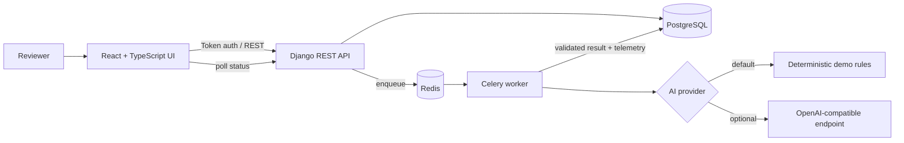

# AI Casework Review

An evidence-grounded case analysis application built as an **independent portfolio project**. It is not employer production work and does not claim professional deployment or usage. The project demonstrates a complete, modest vertical slice for a Senior Full Stack AI role: authenticated case submission, asynchronous analysis, observable execution, structured results, evaluation, tests, containers, CI, and a bounded cloud example.

## Architecture



The API treats submitted text and model output as untrusted. Input is bounded and validated, ownership is enforced on every case query, jobs are deduplicated by per-user content hash, and provider output must pass a Pydantic schema before persistence. Findings contain verbatim source evidence.

## Quick start

Requirements: Docker Desktop and Docker Compose.

```bash
cp .env.example .env
# Set DJANGO_SECRET_KEY and POSTGRES_PASSWORD in .env.
docker compose up --build
```

Open <http://localhost:5173>, create a demo account, and submit the prefilled privacy escalation. API documentation is at <http://localhost:8000/api/docs/> and health is at <http://localhost:8000/api/v1/health/>.

Demo mode is deterministic and requires no paid credentials. To use an OpenAI-compatible endpoint, set `AI_PROVIDER`, `AI_MODEL`, `AI_API_KEY`, and optionally `AI_API_URL`. Provider failures or invalid structured output produce a visible `provider_fallback` state and a safe deterministic result rather than an invented success.

## Local development

Backend:

```bash
python -m venv .venv
source .venv/bin/activate  # Windows PowerShell: .venv\Scripts\Activate.ps1
pip install -r requirements.txt
python manage.py migrate
CELERY_TASK_ALWAYS_EAGER=true pytest
python -m evaluation.run
python manage.py runserver
```

For real asynchronous processing, run Redis and start `celery -A config worker --loglevel=INFO`. Without `POSTGRES_HOST`, local development uses SQLite; Docker Compose and the AWS example use PostgreSQL.

Frontend:

```bash
cd frontend
npm ci
npm test
npm run build
npm run test:e2e
npm run dev
```

## API and job behavior

- DRF token authentication, owner-only permissions, page-number pagination, OpenAPI schema, and uniform error envelopes.
- `POST /api/v1/cases/` validates 30–12,000 characters, applies a configurable daily usage limit, and deduplicates identical text for the same user.
- Celery jobs persist queued/processing/completed/failed progress, use soft and hard time limits, retry rate limits/timeouts with backoff and jitter, and can be recovered through the retry action.
- Completed cases are idempotent: duplicate task delivery returns the persisted result.
- Each run records provider, model, prompt version, token counts, latency, status, retries, error code, timestamps, and correlation ID. Each case also has a trace ID.

## AI safety and evaluation

`DemoProvider` is intentionally simple and transparent. It emits only configured categories and quotes evidence directly from the input. The optional provider receives a JSON schema and temperature zero, then its response is validated. Invalid output, missing credentials, or provider errors trigger deterministic fallback with an explicit limitation.

Versioned fixtures live in `evaluation/fixtures/v1/`. Run `python -m evaluation.run` to calculate:

- **unsupported claim rate**: findings whose evidence quote is absent from the source;
- **false-positive rate**: forbidden categories incorrectly returned;
- **miss rate**: expected categories not returned.

These fixtures are regression checks, not proof of fairness or production readiness. A real system needs representative, consented datasets; slice analysis; adversarial and prompt-injection tests; calibrated thresholds; reviewer disagreement tracking; and independent governance.

## Testing and CI

- Pytest covers API validation, authentication isolation, deduplication, task execution, and evidence grounding.
- React Testing Library/Vitest covers account creation and result rendering.
- Playwright covers the browser happy path with deterministic API interception.
- GitHub Actions validates Django/OpenAPI, backend tests, evaluation metrics, frontend tests/build, Playwright, and both Docker images.

## Design tradeoffs

- Polling is used instead of WebSockets to keep the vertical slice understandable and deployable.
- DRF token auth demonstrates permissions without introducing a third-party identity provider. Production should use short-lived OIDC/OAuth tokens.
- The demo provider favors reproducibility over linguistic coverage. It is safe to run locally but deliberately limited.
- Content-hash deduplication is scoped per user; production may need configurable retention and salted/encrypted fingerprinting.
- The Terraform example is intentionally incomplete as a landing zone. It demonstrates resource boundaries while documenting security and cost work still required.

## AWS example

`terraform/` includes bounded ECS Fargate task definitions for web/API/worker plus encrypted RDS PostgreSQL and ElastiCache Redis. It is an example only and is not automatically deployed. Read [`terraform/README.md`](terraform/README.md) before planning it; HTTPS, private networking, secrets injection, full services/load balancing, monitoring, and budgets are required before real use.

## Skills demonstrated

- Django, Django REST Framework, PostgreSQL modeling, auth, permissions, validation, pagination, and OpenAPI.
- Celery/Redis orchestration, retries, timeouts, progress, idempotency, deduplication, and failure recovery.
- React 19, strict TypeScript, Tailwind CSS, responsive layout, semantic markup, keyboard focus, and accessible live status.
- Provider abstraction, schema-constrained outputs, prompt/model versioning, usage limits, deterministic fallback, observability, and executable AI evaluation.
- Pytest, React Testing Library, Playwright, Docker, Compose, GitHub Actions, and AWS Terraform.

## CV-ready portfolio summary

> Built an independent full-stack AI casework review application using Django REST Framework, Celery/Redis, PostgreSQL, React/TypeScript, and Tailwind. Implemented authenticated evidence-grounded analysis, idempotent async jobs with retries/timeouts, structured AI validation and fallback, end-to-end observability, versioned evaluation metrics, automated tests, containerized local deployment, CI, and a documented AWS reference architecture.

## Roadmap

- OIDC authentication and role-based reviewer/admin permissions.
- Server-sent events for progress and cancellation.
- Encrypted/redacted source text, configurable retention, audit exports, and deletion workflows.
- Human feedback capture, richer evaluation datasets, fairness slices, and provider comparison.
- Production Terraform modules with private networking, ALB/ACM/WAF, Secrets Manager, autoscaling, alarms, and budgets.

## License and contributing

Licensed under the MIT License. See [CONTRIBUTING.md](CONTRIBUTING.md) for development and responsible-AI contribution expectations.
